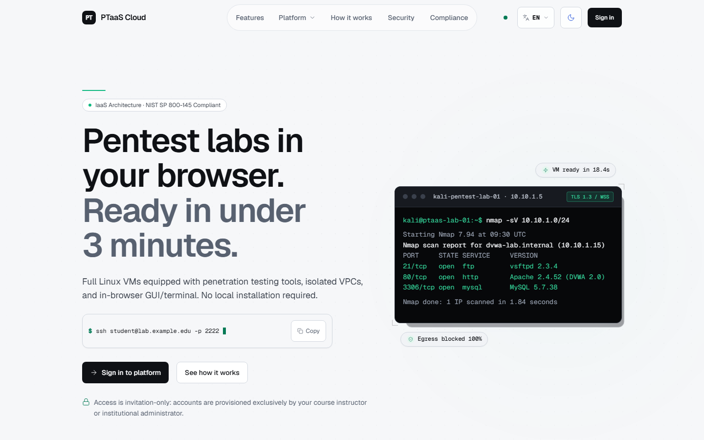
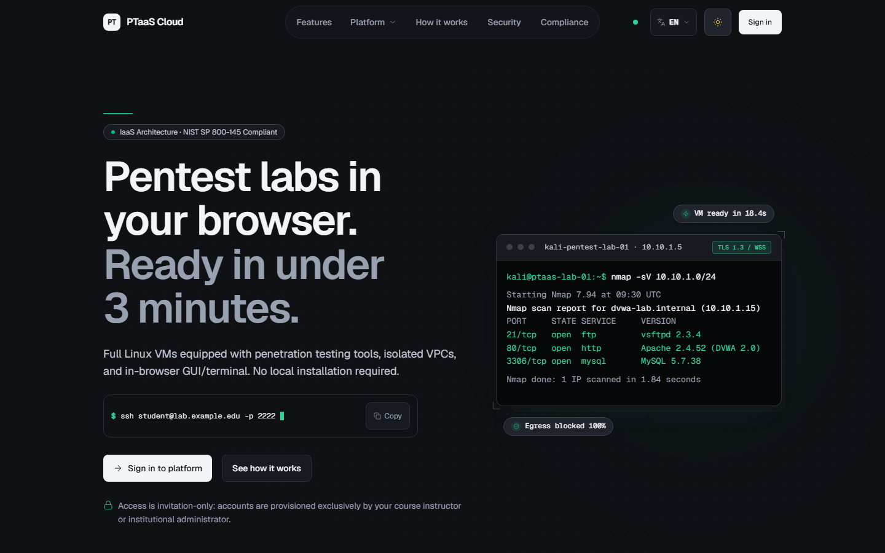
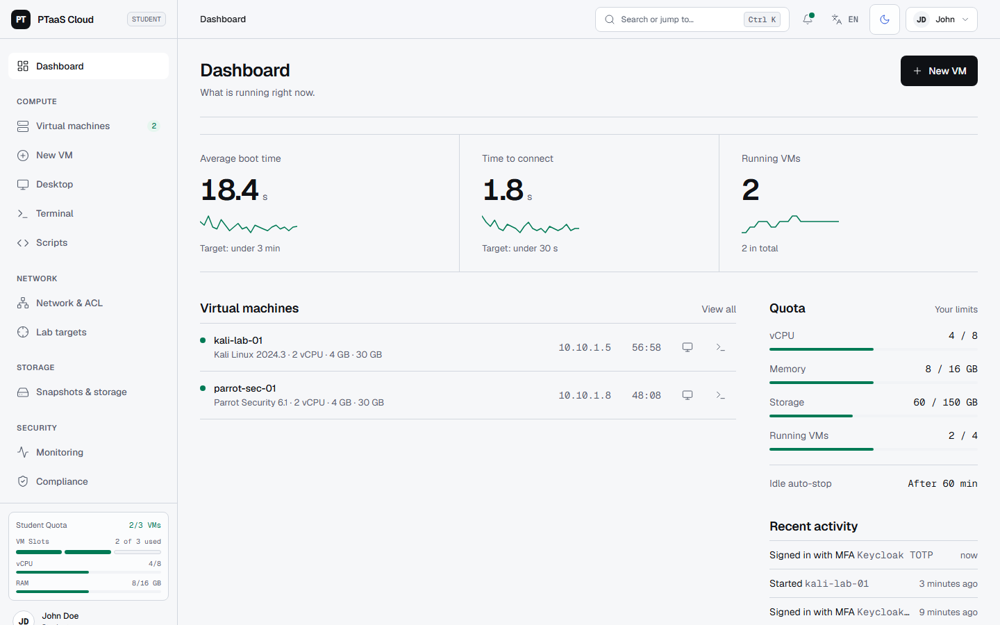
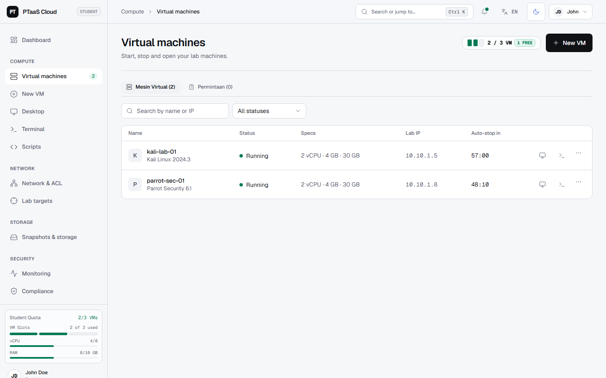
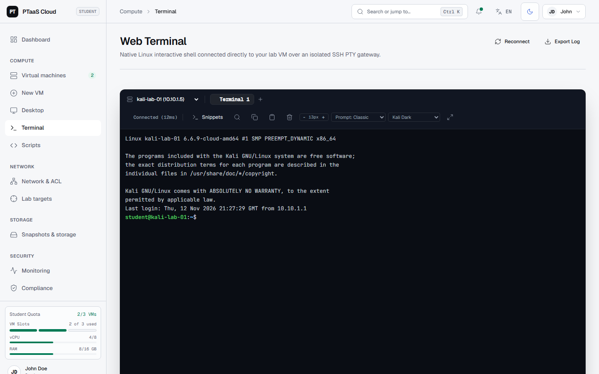
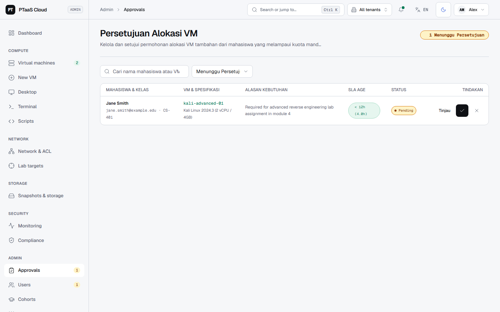
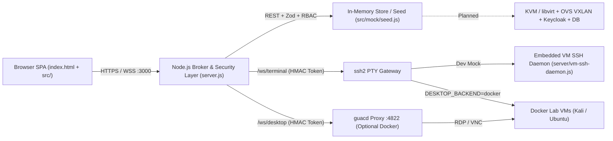
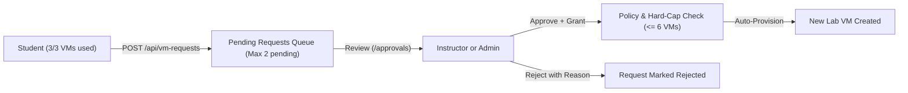

# PTaaS Cloud

**Penetration Testing as a Service — browser-based, isolated cybersecurity lab VMs with zero local setup.**


> **Demo Mode & Gateway Notice:** The deployable Next.js application (`npm run build && npm start`, Vercel-ready) runs strictly in **Demo Mode** (`NEXT_PUBLIC_DEMO_MODE=true`, `DEMO_MODE=true`, defaulting to `true` when omitted): the Web Terminal is a deterministic in-memory simulation (`"Demo simulation: not a real shell"`), Remote Desktop is a static preview, Exploit Code Studio outputs canned responses, and VM actions operate on in-memory seed data with zero host-shell or hypervisor access. The optional local WebSocket/PTY/Guacamole server and Docker Compose stack live in [`gateway/`](./gateway/README.md) and are **not part of the Vercel demo deployment**.

---

## Ringkasan (Bahasa Indonesia)

**PTaaS Cloud** adalah prototipe platform *Penetration Testing as a Service* berbasis web dengan arsitektur IaaS untuk praktikum keamanan siber di lingkungan akademik. Mahasiswa dapat menjalankan mesin virtual (Kali Linux, Parrot OS, Ubuntu) langsung dari browser melalui **Remote Desktop** (Guacamole/RDP/VNC) dan **Web Terminal** (xterm.js + SSH PTY) tanpa instalasi lokal. Sistem ini menerapkan isolasi jaringan *multi-tenant*, pembatasan kuota mandiri maksimal 3 VM per mahasiswa dengan alur persetujuan dosen/admin untuk VM tambahan, autentikasi MFA TOTP, serta kebijakan *zero public egress* terhadap target lab yang sengaja dibuat rentan (DVWA, Metasploitable, Juice Shop).

---

## Overview

Cybersecurity students need hands-on practice with offensive security tools (Nmap, Metasploit, Burp Suite, SQLmap) against vulnerable targets, without risking host compromise, local virtualization overhead, or accidental traffic leaks to institutional or public networks.

PTaaS Cloud addresses this by providing browser-accessible virtual machines inside isolated per-cohort virtual networks, paired with server-enforced quotas and automated idle resource reclamation.

**PRD Performance & Isolation Targets** (from [PRD PTaaS Cloud Platform.md](./PRD%20PTaaS%20Cloud%20Platform.md)):

- **VM Boot Time:** `< 3 minutes` (target)
- **GUI / Terminal Connect:** `< 30 seconds`
- **Cross-Tenant Leakage:** `0` (strict tenant segmentation)
- **Public Egress Policy:** `100%` dropped outside lab target CIDRs

**Intended Users:**

- **Students:** Launch lab VMs (up to 3 self-service VMs), access GUI/terminal/script studio, and request extra VMs when needed.
- **Instructors:** Manage cohort students, review and approve/reject extra VM requests, and monitor lab usage.
- **Administrators:** Configure system-wide VM policies, manage all users/cohorts, and inspect security audit logs.

---

## Table of Contents

- [Ringkasan (Bahasa Indonesia)](#ringkasan-bahasa-indonesia)
- [Overview](#overview)
- [Project Status and Scope](#project-status-and-scope)
- [Screenshots](#screenshots)
- [Features](#features)
- [Architecture](#architecture)
- [Tech Stack](#tech-stack)
- [Repository Structure](#repository-structure)
- [Getting Started](#getting-started)
- [Demo Accounts (Development Only)](#demo-accounts-development-only)
- [Usage Guide by Role](#usage-guide-by-role)
- [Security](#security)
- [Testing and Quality](#testing-and-quality)
- [Configuration and Customization](#configuration-and-customization)
- [Deployment Notes](#deployment-notes)
- [Performance and Accessibility Notes](#performance-and-accessibility-notes)
- [Troubleshooting](#troubleshooting)
- [Roadmap](#roadmap)
- [Contributing](#contributing)
- [Documentation Index](#documentation-index)
- [License and Acknowledgements](#license-and-acknowledgements)

---

## Project Status and Scope

| Area / Feature | Status | Implementation Notes |
| :--- | :--- | :--- |
| Landing Page, Motion & Scroll Spy | **Implemented** | `src/features/landing/landing.js`, `src/lib/active-section.js`, `motion` + `lenis`, ID/EN i18n, Light/Dark theme |
| Login, MFA TOTP & Lockout | **Implemented (Dev Seed)** | `POST /api/auth/login`, `POST /api/auth/mfa`, 5-attempt lockout, `/register` & `/signup` return `404` |
| RBAC & Route Guards | **Implemented** | `student`, `instructor`, `admin` guards in `src/app/routes.js` & `server/security.js` |
| VM List, 5-Step Create Wizard & Quotas | **Implemented (In-Memory / Docker)** | Max 3 self-service VMs (`maxSelfServiceVms`), hard cap 6, mutex concurrency lock in `server.js` |
| Extra VM Request & Approval Workflow | **Implemented (In-Memory)** | `POST /api/vm-requests`, instructor/admin `/approvals` queue, max 2 pending requests |
| Web Terminal (`xterm.js` + SSH PTY) | **Implemented (Docker / Simulated VM)** | `/ws/terminal` connects via `ssh2` to VM container or `server/vm-ssh-daemon.js`; zero host shell access |
| Remote Desktop (Guacamole Tunnel) | **Implemented (Docker `guacd` / Mock)** | `/ws/desktop` tunnels to `guacd` (`4822`) when `DESKTOP_BACKEND=docker`; simulated fallback otherwise |
| Exploit Code Studio | **Implemented (Sandboxed Mock)** | `POST /api/scripts/run` validates language/payload and returns sandboxed execution output |
| Network & ACL, Lab Targets, Storage, Monitoring | **Mocked (UI + Seed Data)** | Interactive UI backed by `src/mock/seed.js` and Zod validation |
| Compliance Page (NIST SP 800-145) | **Implemented (Static / UI)** | `src/features/security/compliance.js` |
| User, Cohort, Policy & Audit Management | **Implemented (In-Memory / UI)** | `/admin/users`, `/admin/cohorts`, `/admin/policies`, `/admin/audit` |
| KVM / libvirt & Open vSwitch VXLAN SDN | **Planned** | Image templates in `images/` (`Dockerfile`, `cloud-init.yaml`, Packer HCL); no live hypervisor |
| Keycloak Enterprise SSO & PostgreSQL | **Planned** | Target production IAM and persistent database; currently mocked by `src/mock/seed.js` |

> **Note on `package.json` vs. `server.js`:** `package.json` lists Next.js (`dev`, `build`, `start` scripts), while the active application runtime is a custom Node.js HTTP/WebSocket server (`server.js`) serving `index.html` and vanilla ES modules from `src/`. Use `node server.js` (or `start.bat`) to run the platform.

---

## Screenshots

| Light Landing Hero | Dark Landing Hero |
| :---: | :---: |
|  |  |

| Student Dashboard | Virtual Machine Inventory |
| :---: | :---: |
|  |  |

| Web Terminal (xterm.js + SSH PTY) | Instructor / Admin Approvals |
| :---: | :---: |
|  |  |

---

## Features

- **Compute (`src/features/vm/`):** 5-step VM creation wizard (Kali 2024.3, Parrot 6.1, Ubuntu 24.04), lifecycle controls (start, stop, restart, delete), 60-minute idle auto-stop ticker (`idle-ticker.js`), server-enforced limit of 3 self-service VMs per student, and extra-VM request modal.
- **Access (`src/features/desktop/`, `src/features/terminal/`, `src/features/studio/`):**
  - Browser Remote Desktop (`guacamole-common.js` over `/ws/desktop` -> `guacd`).
  - Web Terminal (`@xterm/xterm` 6.0 with fit, search, unicode11, and web-links addons over `/ws/terminal` -> `ssh2` -> VM SSH daemon or Docker container).
  - Exploit Code Studio (`/studio`) for running validated lab scripts.
- **Network & Targets (`src/features/network/`, `src/features/targets/`):** Per-tenant VXLAN visualization (`10.10.1.0/24` vs `10.10.3.0/24`), ACL rule builder, and lab target directory (`dvwa-lab`, `metasploitable-01`, `juice-shop-01` in `10.10.2.0/24`).
- **Storage & Monitoring (`src/features/storage/`, `src/features/security/`):** Snapshot and CoW disk quota views, live security monitoring, and NIST SP 800-145 compliance mapping.
- **Administration (`src/features/admin/`):** Role-scoped user management (no public sign-up), cohort management, extra-VM approval queue (`/approvals`), policy editor (`/admin/policies`), and append-only audit log (`/admin/audit`).
- **UX & Accessibility:** Bilingual ID/EN switcher (`src/lib/i18n.js`), Light/Dark theme with zero-flicker persistence (`src/lib/theme.js`), token-driven color system (`src/styles/tokens.css`), `Ctrl/Cmd + K` command palette, `motion` + `lenis` smooth scroll, deterministic scroll-spy header, and `prefers-reduced-motion` support.

---

## Architecture



### Extra-VM Request & Approval Flow



---

## Tech Stack

| Layer | Technology | Version (`package.json`) | Purpose |
| :--- | :--- | :--- | :--- |
| Runtime & Server | Node.js + built-in `http` | `22+` (recommended) | Serves SPA, REST APIs, security headers, and WebSocket tunnels (`server.js`) |
| Frontend | Vanilla ES Modules + Tailwind CSS | Tailwind `3.4.17` | Zero-build SPA (`src/app/main.js`) with CSS custom property tokens |
| Motion & Scroll | `motion` + `lenis` | `14.7.1` / `1.3.27` | Tree-shaken ESM vendor chunks (`motion-mini.mjs` `3.19 KB` gzip) |
| Web Terminal | `@xterm/xterm` + addons + `ssh2` | `6.0.0` / `1.17.0` | Interactive browser PTY over WebSocket to VM SSH only |
| Validation & Security | `zod` + `server/security.js` | `4.6.7` | Strict schema validation, CSRF, rate limiting, CSP, SSRF/XSS guards |
| Remote Desktop (Dev) | Apache Guacamole (`guacd`) + Kasm | `1.5.5` / `1.15.0` | Optional containerized desktop/SSH targets (`docker-compose.dev.yml`) |
| Testing & QA | Playwright + Node `assert` | `1.65.0` | Security suite, VM limits, scroll-spy, motion, and accessibility QA |
| Declared (Unused) | Next.js / React | `15.1.0` / `19.0.0` | Present in `package.json`; runtime uses `server.js` + `index.html` |

---

## Repository Structure

```text
PTaas/
├── server.js                   # HTTP server, REST API broker, /ws/terminal & /ws/desktop tunnels
├── server/
│   ├── security.js             # Zod schemas, RBAC, CSRF, rate limiter, CSP & input sanitizers
│   └── vm-ssh-daemon.js        # Embedded SSH2 PTY daemon for isolated in-memory VM simulation
├── index.html                  # SPA entry document
├── src/
│   ├── app/                    # Router entry, routes table, shell layout, sidebar nav
│   ├── components/             # Landing sections, header (scroll spy + pill), UI primitives
│   ├── features/               # Page views (landing, login, vm, desktop, terminal, studio, admin)
│   ├── lib/                    # Auth, API client, motion, scroll-controller, active-section, i18n
│   ├── mock/                   # RFC 2606 seed data (users, cohorts, VMs, audit logs)
│   └── styles/                 # Design tokens (tokens.css) and global styles (app.css)
├── scripts/                    # Color check, demo data check, Motion vendor builder, contrast audit
├── tests/                      # Security, terminal isolation, VM limits, scroll spy & motion QA tests
├── images/                     # VM golden-image templates (Dockerfile, cloud-init.yaml, Packer)
├── docs/                       # Color architecture (COLORS.md) and README screenshots
├── docker-compose.dev.yml      # Optional guacd + Kali/Ubuntu desktop containers
├── start.bat                   # Windows quick-start launcher (runs node server.js on :3000)
├── SECURITY.md                 # Threat model, headers, and vulnerability reporting policy
└── PRD PTaaS Cloud Platform.md # Product Requirements Document (Versi 1.0)
```

---

## Getting Started

### Prerequisites

- **Node.js `22+`** and **npm** (lockfile: `package-lock.json`)
- **Git**
- **Optional (for real Docker VMs & Guacamole desktop):** Docker Desktop (with WSL2 backend on Windows) or Docker Engine on Linux/macOS

### 1. Clone and Install

```bash
git clone <repository-url>
cd PTaas
npm install
```

### 2. Configure Environment

Copy `.env.example` to `.env` (optional — defaults work out of the box in mock/simulation mode):

```bash
cp .env.example .env
```

```powershell
# PowerShell (Windows)
Copy-Item .env.example .env
```

| Variable | Required? | Default / Example | Description |
| :--- | :--- | :--- | :--- |
| `PORT` | No | `3000` | Port for `server.js` HTTP and WebSocket endpoints |
| `NODE_ENV` | No | `development` | Enables production cookie/header behavior when set to `production` |
| `DESKTOP_BACKEND` | No | *(unset)* / `docker` | Set to `docker` to connect `/ws/desktop` & SSH to `docker-compose.dev.yml` containers |
| `GUACD_HOST` | No | `127.0.0.1` | Hostname for Apache Guacamole `guacd` daemon |
| `GUACD_PORT` | No | `4822` | Port for `guacd` daemon |

### 3. Run in Development

**Mode A — Standalone Prototype (Mocked VMs + Embedded VM SSH Daemon):**

```bash
node server.js
```

On Windows, you can also double-click `start.bat` or run:

```powershell
.\start.bat
```

**Mode B — With Real Docker Desktop/SSH Containers + Guacamole:**

```bash
docker compose -f docker-compose.dev.yml up -d
```

```bash
# Linux / macOS
DESKTOP_BACKEND=docker node server.js
```

```powershell
# PowerShell (Windows)
$env:DESKTOP_BACKEND="docker"; node server.js
```

Open `http://localhost:3000` in your browser.

### 4. Verify It Works

1. Open `http://localhost:3000` and confirm the landing page loads.
2. Click **Sign in**, enter `john.doe@example.edu` and `password123`, then enter any 6-digit MFA code (e.g., `123456`).
3. Open **Web Terminal** (`/terminal`), select a running VM, and run `whoami` or `ls`.

---

## Demo Accounts (Development Only)

> **Warning:** These accounts are seeded from `src/mock/seed.js` using RFC 2606 (`@example.edu` / `@example.com`) placeholders for local development only. **Never deploy these credentials to production.**

| Role | Name | Email | Password | Notes |
| :--- | :--- | :--- | :--- | :--- |
| `student` | John Doe | `john.doe@example.edu` | `password123` | Cohort `CS-401`; 2/3 VMs used (can create 1 more) |
| `student` | Jane Smith | `jane.smith@example.edu` | `password123` | Cohort `CS-401`; 3/3 VMs used (1 pending extra-VM request) |
| `instructor` | Dr. Sarah Johnson | `sarah.johnson@example.edu` | `password123` | Manages `CS-401` and `CS-402`; can approve VM requests |
| `admin` | Alex Morgan | `admin@example.com` | `password123` | Full access to `/admin/policies`, `/admin/users`, `/admin/audit` |

**MFA Behavior in Dev:** Submitting valid credentials advances to the 6-digit TOTP step; `POST /api/auth/mfa` accepts any 6-digit code in development mode.

---

## Usage Guide by Role

### Student
1. Sign in at `/login` (quick-demo buttons are available below the form).
2. View active VMs and quota usage on `/dashboard` or `/vms`.
3. Launch a new VM via `/vms/new` (up to `3` self-service VMs).
4. Connect to a running VM via `/terminal` (Web Terminal) or `/desktop` (Remote Desktop), or run scripts in `/studio`.
5. If you reach the 3-VM limit, submit an extra-VM request from the modal on `/vms` or `/vms/new`.

### Instructor
1. Sign in as `sarah.johnson@example.edu`.
2. Open `/approvals` to review, approve, or reject student extra-VM requests.
3. Manage enrolled students and cohorts at `/admin/users` and `/admin/cohorts`.
4. Inspect cohort activity in `/admin/audit`.

### Administrator
1. Sign in as `admin@example.com`.
2. Configure platform-wide self-service limits and hard caps at `/admin/policies`.
3. Provision user accounts, roles, and quotas at `/admin/users` (public registration is disabled).
4. Review security events and audit trails at `/admin/audit`.

---

## Security

PTaaS Cloud enforces a default-deny security model documented in [SECURITY.md](./SECURITY.md):

- **Implemented Controls:**
  - Mandatory MFA TOTP step, 5-attempt brute-force lockout, uniform `401 invalid_credentials` responses, and `404` on `/register` and `/signup`.
  - Strict security headers (`Content-Security-Policy`, `X-Frame-Options: DENY`, `X-Content-Type-Options: nosniff`, `Strict-Transport-Security`, `Permissions-Policy`).
  - Zod `.strict()` schema validation, prototype-pollution filtering, CSRF origin verification, rate limiting, SSRF IP blocking, and path-traversal checks (`server/security.js`).
  - Terminal & gateway isolation: the public demo web terminal runs an in-memory allow-listed simulation with zero host-shell or network access. The optional local [`gateway/`](./gateway/) server (not deployed to Vercel) requires single-use HMAC-signed tokens and connects only to isolated guest VMs or containers.
- **Planned Production Controls:** Live Open vSwitch VXLAN segmentation, hardware KVM isolation, Keycloak SSO/OIDC, and external secrets management.

> **Warning — Intentionally Vulnerable Targets:** The lab target catalog (`dvwa-lab`, `metasploitable-01`, `juice-shop-01` in `10.10.2.0/24`) represents intentionally vulnerable software. Never expose lab target VMs or `docker-compose.dev.yml` ports to public or institutional production networks.

**Acceptable Use & Responsible Disclosure:** All lab tools and targets are strictly for authorized educational practice. To report a security issue, follow the instructions and SLA in [SECURITY.md](./SECURITY.md).

---

## Testing and Quality

| Check | Command | What It Verifies |
| :--- | :--- | :--- |
| Security Suite | `npm run test:security` | 49 checks: headers, CSP, `/register` 404, SQLi/XSS/NoSQLi/SSRF/traversal, auth lockout, gateway tokens (requires `server.js` running) |
| Terminal Isolation Audit | `npm run test:terminal-security` | Verifies zero host shell/process execution in terminal gateway |
| VM Limits & Concurrency | `node tests/test-vm-limits.js` | 3-VM quota block (`409`), pending limit (`429`), approval flow, 10x parallel mutex test (requires `server.js` running) |
| Scroll Spy Unit Tests | `node tests/active-section.unit.mjs` | 9 assertions: boundaries, hero/bottom rules, `±8px` hysteresis, resized offsets |
| Scroll Spy Playwright QA | `node tests/scroll-spy-qa.mjs` | End-to-end pill alignment (`<= 2px`), hash/history sync, mobile menu, hit-tests (requires `server.js` running) |
| Motion & Smooth Scroll QA | `node tests/motion-scroll-qa.mjs` | Wheel/keyboard/nested scroll, 4x CPU throttle CLS (`< 0.02`), reduced-motion & touch emulation |
| Color & Demo Data Checks | `npm run check:colors` / `npm run check:demo` | Zero raw hex colors outside `tokens.css`; strict RFC 2606 demo identities |

---

## Configuration and Customization

- **Theme Tokens:** Edit CSS custom properties in [src/styles/tokens.css](./src/styles/tokens.css) (documented in [docs/COLORS.md](./docs/COLORS.md)). Press `Ctrl+Shift+K` in dev mode to open the live Color Tuner (`/dev/colors`).
- **Languages (ID / EN):** Translations live in [src/lib/i18n.js](./src/lib/i18n.js).
- **Motion & Decoration Level:** Configured in [src/lib/motion.js](./src/lib/motion.js) and [src/components/landing/decor/config.js](./src/components/landing/decor/config.js). Rebuild tree-shaken Motion/Lenis chunks with `node scripts/build-motion-vendor.mjs`.
- **VM Policies:** Default limits (`maxSelfServiceVms: 3`, `hardCapVms: 6`, `grantValidityDays: 7`) are defined in `server.js` and editable at runtime by admins via `/admin/policies`.
- **VM Images & Lab Targets:** Packer/Docker/cloud-init templates are in `images/` (`kali`, `parrot`, `ubuntu`).

---

## Deployment Notes

The current repository runs as a **single-node prototype** (`server.js` + in-memory state). A full production deployment per the PRD requires:

1. **Hypervisor Host:** KVM/QEMU + `libvirt` on bare-metal Linux with hardware virtualization (`Intel VT-x` / `AMD-V`).
2. **SDN Isolation:** Open vSwitch bridges with VXLAN VNI per cohort and strict `0.0.0.0/0 DROP` egress ACLs.
3. **IAM & Persistence:** Keycloak (OIDC + mandatory TOTP MFA) and PostgreSQL for persistent VM/quota/audit records.
4. **Edge & Gateways:** TLS 1.3 reverse proxy + OWASP CRS WAF in front of `server.js` and `guacd`.

---

## Performance and Accessibility Notes

- **Initial Motion JS:** `src/lib/vendor/motion-mini.mjs` is `3.19 KB` gzip (`<= 15 KB` budget); `motion-core.mjs` and `lenis.mjs` lazy-load after first paint.
- **Reduced Motion & Touch:** Respects `prefers-reduced-motion: reduce` (disables Lenis and scroll-linked parallax; instant pill jumps) and disables Lenis/sticky scenes on touch devices.
- **Accessibility & Layout Stability:** Semantic landmarks, `aria-current="location"` on active nav links, keyboard-navigable dropdowns/menus, and verified `CLS < 0.02` in Playwright QA.

---

## Troubleshooting

- **Port `3000` already in use:** Stop the existing Node process or set `PORT=3001 node server.js`.
- **Terminal says VM is stopped (`409 Conflict`):** Start the VM in `/vms` before opening `/terminal`.
- **Docker desktop/SSH backend fails:** Ensure Docker Desktop is running and `docker compose -f docker-compose.dev.yml up -d` succeeded before setting `DESKTOP_BACKEND=docker`. Without Docker, unset `DESKTOP_BACKEND` to use the built-in simulated VM SSH daemon.
- **`npm run test:security` fails with `EACCES` or `ECONNREFUSED`:** Start `node server.js` in another terminal before running `npm run test:security` or Playwright suites.
- **Motion vendor chunks out of date:** Run `node scripts/build-motion-vendor.mjs` after updating `motion` or `lenis`.
- **Windows line-ending / WSL path confusion:** The web terminal connects exclusively to the VM SSH daemon (`10.10.1.x` / `2222`), never to host WSL or PowerShell.

---

## Roadmap

- [ ] Replace in-memory `vmRegistry` and `vmRequests` with PostgreSQL persistence
- [ ] Integrate `libvirt` API driver for real KVM/QEMU VM provisioning from `images/`
- [ ] Automate Open vSwitch VXLAN bridge and ACL rule provisioning per cohort
- [ ] Connect Keycloak OIDC + TOTP authentication in place of dev seed accounts
- [ ] Align `package.json` scripts (`dev`, `start`) with `server.js` or complete Next.js migration

---

## Contributing

1. Create a feature branch from `main`.
2. Keep color tokens inside `src/styles/tokens.css` and demo identities strictly RFC 2606 compliant.
3. Run checks before opening a PR:

```bash
npm run check:colors
npm run check:demo
npm run test:terminal-security
node tests/active-section.unit.mjs
```

---

## Documentation Index

- [PRD PTaaS Cloud Platform.md](./PRD%20PTaaS%20Cloud%20Platform.md) — Product Requirements Document (Versi 1.0)
- [SECURITY.md](./SECURITY.md) — Threat model, security headers, and vulnerability reporting
- [docs/COLORS.md](./docs/COLORS.md) — Semantic color token architecture

---

## License and Acknowledgements

- **License:** `TODO` — No `LICENSE` file is currently present in the repository. Add an appropriate open-source or institutional license before public distribution.
- **Acknowledgements:** Built with [xterm.js](https://xtermjs.org/), [Motion](https://motion.dev/), [Lenis](https://lenis.darkroom.engineering/), [Tailwind CSS](https://tailwindcss.com/), [Zod](https://zod.dev/), [ssh2](https://github.com/mscdex/ssh2), [Apache Guacamole](https://guacamole.apache.org/), and [Kasm Workspaces](https://www.kasmweb.com/) dev images.

*Last updated: 2026-11-13*
